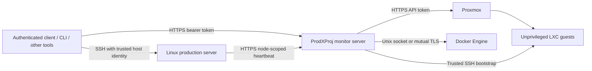

# Architecture

ProdXProj has three roles. The client compiles, packages, opens, compares and deploys projects. The optional monitor server stores production status, release metadata and encrypted packages, and calls infrastructure APIs. A production-side reporter runs from cron and sends HTTPS heartbeats. Viewing clients do not perform monitoring and can disconnect without interrupting it.



The SSH worker is transmitted for each operation. It uses only the standard library and exposes no inbound API. Persistent reporter and backup cron jobs are optional. Project services remain the responsibility of configured activation hooks, such as systemd or Docker Compose commands.

## Custom history

`.prox/history.db` is a SQLite release graph, not a Git repository. Each build has a UUID, a project UUID, branch name, parent release, creation time, creator, source folder, machine, platform, file metadata, settings fingerprints and release note. `branch` selects a separate line of development; `fork` creates a new project UUID and records the originating project and release. New builds automatically link to the current branch head.

Packages carry prior graph metadata. Unpacking or importing a package restores its ancestry. `publish` shares redacted history and an encrypted artifact with the central server. Other authenticated clients can fetch packages or synchronize history and render their own topology view. The graph records changes between release snapshots; it does not continuously observe every editor keystroke.

`compare --text` can show ordinary text-file changes between unlocked artifacts. Environment files, credential sections, data and generated hook configuration are excluded from text diffs.

## Server state

```text
<deployment-root>/
  active.json
  current -> releases/<release-uuid>/
  releases/<release-uuid>/
  shared/
  backups/<timestamp>-<uuid>.zip
  restores/<restore-name>/
  reporter/                 # optional
  backup-runner/            # optional
```

The client strips deployment credentials and history from the transmitted runtime payload. `.env` files are installed only when selected. Existing shared data is preserved; seed-data conflicts abort deployment. Application rollback does not undo database migrations or arbitrary hook side effects.
